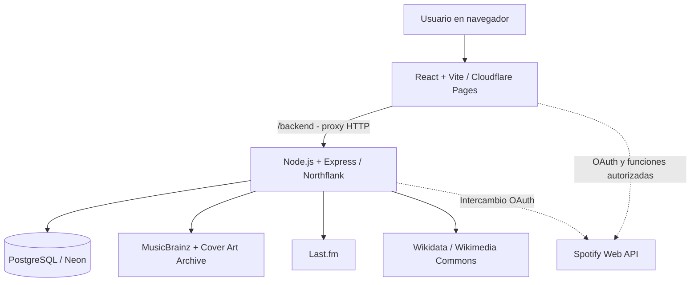

# EchoHead 🎧

**Tu diario musical: descubre álbumes, registra escuchas, califica, escribe reseñas y construye un perfil alrededor de tu música.**

[**🌐 Probar la aplicación (Live Demo)**](https://echohead-web.pages.dev/) · [**💻 Explorar el código**](https://github.com/lizq237/echohead-web)

> **Proyecto personal full stack · 2026 — en evolución**  
> Desarrollado por **Lizeth Quiroz Urias**. Aplicación web desplegada con registro independiente de Spotify.

EchoHead es una plataforma inspirada en la idea de un diario cultural: en lugar de guardar películas, los usuarios pueden llevar un registro de los álbumes y canciones que les gustan, calificarlos, reseñarlos y compartir su identidad musical.

## ⚡ Pruébalo en unos minutos

**No necesitas clonar el repositorio ni tener Spotify para probar las funciones principales.**

### 1. Crea tu cuenta

1. Abre **[EchoHead](https://echohead-web.pages.dev/)**.
2. Selecciona **Crear cuenta**.
3. Introduce un **nombre visible**, un **usuario** (de 3 a 32 caracteres: letras sin acentos, números o `_`) y una **contraseña de al menos 15 caracteres**.
4. Guarda la **clave de recuperación** que aparecerá después del registro. El sistema te pedirá confirmar que la guardaste.
5. Continúa hacia tu perfil musical.

**Importante:** el registro propio **no solicita correo electrónico**. Si olvidas la contraseña, la recuperación se hace con tu usuario y la clave de recuperación, no por correo. Guárdala de forma privada; nunca la compartas ni la incluyas en capturas de pantalla.

### 2. Recorrido recomendado para evaluación

| Paso | Qué probar | Qué deberías poder comprobar |
| --- | --- | --- |
| 1 | **Álbumes** → busca un artista o disco | Búsqueda en el catálogo MusicBrainz, sin Spotify |
| 2 | Abre un resultado y **califícalo o escribe una reseña** | Registro de una opinión en tu cuenta |
| 3 | Márcalo como **favorito**, **escuchado** o **pendiente** | Estados guardados en tu colección |
| 4 | Visita **Perfil** | Tus álbumes, canciones, reseñas, favoritos y pendientes |
| 5 | Personaliza tu perfil y agrega favoritos destacados | Presentación de tus gustos musicales |
| 6 | Regresa a **Inicio** | Sección «De tus pendientes» y selección musical de EchoHead |
| 7 | Cierra sesión y vuelve a entrar | Persistencia de tus datos entre sesiones |

**Prueba sugerida:** busca un álbum que conozcas, califícalo, márcalo como pendiente y comprueba en tu perfil cómo cambia su estado. Puedes repetirlo con una canción.

La disponibilidad de imágenes y metadatos depende de los servicios externos. Si un álbum no tiene portada, puede mostrarse un recurso de respaldo.

### 3. Integraciones opcionales

- **Spotify:** conexión OAuth disponible para usuarios autorizados de la beta. Permite utilizar funciones asociadas a su catálogo y cuenta de Spotify, así como ciertas funciones de reproducción. **No es necesaria para crear una cuenta ni usar el diario musical básico.**
- **Last.fm:** en **Cuenta → Conectar con Last.fm**, puedes vincular una cuenta con historial de escuchas. La sección **«Tu mes en bucle»** muestra artistas, álbumes y canciones destacadas del último mes. Para ver estadísticas significativas, Last.fm debe tener reproducciones registradas.
- **Catálogo independiente:** sin Spotify, las búsquedas de álbumes y canciones utilizan **MusicBrainz** y las portadas disponibles en **Cover Art Archive**.

> **Nota para evaluadores:** si no tienes cuenta de Last.fm o no estás autorizado para la beta de Spotify, aún puedes evaluar registro, catálogo, reseñas, calificaciones, listas, perfil y persistencia.

## ✨ Funcionalidades principales

- Registro e inicio de sesión con credenciales propias, recuperación mediante clave y conexión opcional a Spotify.
- Búsqueda y exploración de álbumes y canciones.
- Valoraciones, reseñas y estados **escuchado / favorito / pendiente**.
- Perfil musical personalizable con colecciones, favoritos destacados y seguimiento de otros perfiles.
- Estadísticas personales exportables como imagen, cuando exista información musical disponible.
- Selecciones editoriales y recomendaciones en Inicio.
- Integración opcional con Last.fm y Spotify.

**Alcance:** EchoHead es un diario y catálogo musical, **no un servicio de streaming independiente**. La reproducción y el control de Spotify dependen de una conexión autorizada y de las capacidades ofrecidas por Spotify.

## 🛠️ Stack tecnológico

| Capa | Tecnologías |
| --- | --- |
| Frontend | React 19, Vite 8, JavaScript, CSS, React Router |
| Backend | Node.js 22+, Express 5, API REST |
| Base de datos | PostgreSQL (Neon en la infraestructura publicada) |
| Autenticación | Cuentas propias con hash de contraseña, sesiones mediante cookies HttpOnly y OAuth 2.0 para Spotify |
| Integraciones musicales | Spotify Web API, Last.fm API, MusicBrainz, Cover Art Archive |
| Imágenes de artistas | Wikidata / Wikimedia Commons, cuando exista contenido con créditos adecuados |
| Despliegue | Cloudflare Pages (frontend), Northflank (backend), Neon (PostgreSQL) |
| Herramientas | Git, GitHub, Figma, html2canvas |

### Arquitectura general



El frontend consume la API a través de la ruta `/backend` en el mismo origen. En desarrollo esa ruta usa el proxy de Vite y en la versión publicada utiliza una función de Cloudflare Pages.

## 🔐 Decisiones técnicas relevantes

- **Acceso independiente:** el usuario puede crear una cuenta sin necesitar Spotify.
- **Sesiones del servidor:** cookies HttpOnly; la sesión EchoHead se mantiene separada de la autorización temporal de Spotify.
- **Autenticación OAuth:** el servidor utiliza un flujo autorizado de Spotify, con controles de estado/PKCE.
- **Validación y protección:** validación de entradas con Zod, consultas SQL parametrizadas, limitación de solicitudes y controles de acceso.
- **Catálogo desacoplado:** MusicBrainz permite buscar música aunque Spotify no esté vinculado.
- **Fuentes externas:** integración de APIs con control de errores, límites y caché de consultas, cuando corresponde.

El proyecto sigue en evolución; estas prácticas no equivalen a una auditoría de seguridad formal.

## 🧑‍💻 Ejecutarlo localmente (para desarrolladores)

La forma más sencilla de evaluarlo es la **[demo pública](https://echohead-web.pages.dev/)**. Si quieres estudiar el código o levantar el entorno de desarrollo:

### Requisitos

- Git y **Node.js 22.12+** (con npm).
- PostgreSQL en ejecución.
- Una base de datos de desarrollo creada con permisos para leer y escribir.
- Contacto público de identificación para las consultas a MusicBrainz.

### 1. Clona e instala

```bash
git clone https://github.com/lizq237/echohead-web.git
cd echohead-web

cd backend
npm ci

cd ../frontend
npm ci
```

### 2. Prepara PostgreSQL

En una **base vacía de pruebas**, ejecuta estos archivos en orden desde la raíz del repositorio (sustituye el usuario y nombre de base por los de tu entorno):

```bash
psql -U TU_USUARIO -d TU_BASE -f backend/esquema.sql
psql -U TU_USUARIO -d TU_BASE -f backend/migrations/001_security.sql
psql -U TU_USUARIO -d TU_BASE -f backend/migrations/002_independent_accounts.sql
psql -U TU_USUARIO -d TU_BASE -f backend/migrations/003_profile_photos.sql
psql -U TU_USUARIO -d TU_BASE -f backend/migrations/004_image_credits.sql
```

**No ejecutes estos archivos sobre una base con datos reales sin revisar su contenido y tener un respaldo.** Algunas funciones opcionales de Last.fm utilizan columnas que todavía no están documentadas mediante una migración reproducible en este repositorio; por ello **no se garantiza una instalación local completa de todas las integraciones** a partir de una base vacía.

### 3. Variables de entorno

Copia `backend/.env.example` a `backend/.env` y configura las credenciales de **tu propia base de pruebas**. Para desarrollo local, los valores relevantes incluyen:

```dotenv
NODE_ENV=development
PORT=8888
BIND_HOST=127.0.0.1

DB_HOST=127.0.0.1
DB_PORT=5432
DB_NAME=TU_BASE
DB_USER=TU_USUARIO
DB_PASSWORD=TU_PASSWORD_LOCAL

FRONTEND_ORIGIN=http://localhost:5173
REDIRECT_URI=http://localhost:5173/callback
COOKIE_SECURE=false
COOKIE_SAMESITE=lax
MUSICBRAINZ_CONTACT=tu-correo-de-contacto@example.com
```

El contacto MusicBrainz debe ser real y autorizado por quien opere el servidor, ya que se utiliza en la identificación del cliente de la API. Las credenciales de Spotify y Last.fm son **opcionales para el registro propio y la búsqueda MusicBrainz**, pero se requieren para sus respectivas integraciones.

**Nunca publiques archivos `.env`, tokens ni claves privadas en GitHub.**

### 4. Ejecuta backend y frontend

Terminal 1:

```bash
cd echohead-web/backend
npm start
```

Terminal 2:

```bash
cd echohead-web/frontend
npm run dev
```

Visita **http://localhost:5173**. El proxy de Vite conecta `/backend` con `http://127.0.0.1:8888`.

### 5. Pruebas disponibles

```bash
cd backend
npm test

cd ../frontend
npm run build
npm run lint
```

Estos son los comandos definidos por el proyecto. La existencia de scripts y tests **no implica que se haya verificado su resultado en esta revisión**.

## 📂 Estructura del proyecto

```text
echohead-web/
├── frontend/
│   ├── src/
│   │   ├── pages/            # Inicio, Álbumes, Canciones, Perfil, Cuenta
│   │   ├── components/       # Navbar, colecciones, reproductor, acceso
│   │   └── lib/              # Cliente API y catálogo
│   └── functions/backend/    # Proxy de Cloudflare Pages
├── backend/
│   ├── app.js                # API y rutas
│   ├── server.js             # Inicio del servidor
│   ├── accounts.js           # Cuentas propias y recuperación
│   ├── auth.js               # Sesiones y OAuth
│   ├── catalog.js            # Búsquedas MusicBrainz
│   ├── migrations/           # Evolución del esquema
│   └── test/                 # Pruebas backend
└── README.md
```

## 📸 Capturas y demostración

La **[aplicación publicada](https://echohead-web.pages.dev/)** es la referencia principal para probar EchoHead. Está previsto añadir capturas reales del registro, catálogo, perfil y estadísticas musicales a este README. No se incluyen capturas ficticias.

## ⚠️ Consideraciones para evaluadores

- **Crea una cuenta de prueba con datos ficticios.** No reutilices contraseñas personales.
- Si no guardas la clave de recuperación y olvidas la contraseña, el sistema no permite recuperarla por correo.
- La integración con Spotify está limitada a usuarios autorizados de la beta y no es requisito para la evaluación general.
- Las estadísticas de Last.fm requieren vinculación e historial de escucha; un perfil nuevo podría no mostrar datos.
- Las portadas e imágenes dependen de catálogos y licencias externas; algunos elementos pueden carecer de imagen.
- La demo y el backend dependen de los servicios de alojamiento. Los pasos anteriores se comprobaron contra el código del repositorio, pero **no se ejecutó aquí una prueba completa de registro en producción**.

## 👩‍💻 Autora

**Lizeth Quiroz Urias** — Desarrollo full stack, diseño e integración de servicios externos.

[GitHub](https://github.com/lizq237) · [LinkedIn](https://www.linkedin.com/in/lizeth-quiroz-urias)

---

*EchoHead es un proyecto personal e independiente, no afiliado a Spotify, Last.fm ni MusicBrainz.*
